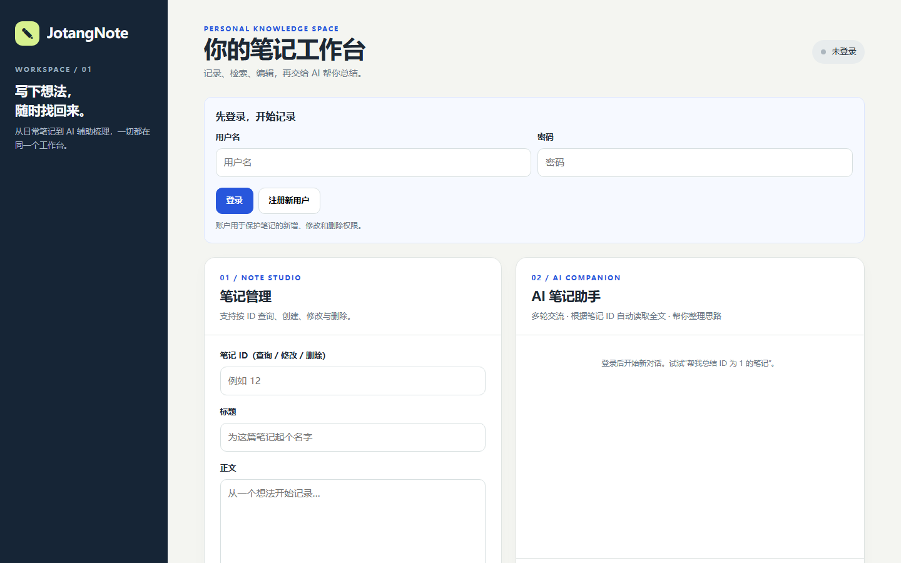

# 进阶篇 Part 2–4：会话管理、Tool Use 与网页

> 2026-10-14。代码与模拟测试完成；尚未配置真实 AI Key。截图为实际网页加载，不代表真实 AI 已回复。

## 使用流程

1. 启动 FastAPI，浏览器打开 http://虚拟机IP:8080/。注册或登录后，JWT 由浏览器在本次会话中保存。
2. 页面可根据 ID 查询笔记，或新建、修改、删除笔记；异步写入时会查询任务状态。
3. 在 AI 助手输入问题，首次 POST /chat 只传 message；服务端生成 conversation_id 并返回 reply。
4. 后续 POST /chat 同时传入 message 和前一次返回的 conversation_id，实现追问。点击“新对话”清空网页中的会话 ID。
5. AI 若需查询笔记，自动触发 get_note_by_id 工具；用户只会看到最终自然语言回复。

~~~text
POST /chat + JWT
  → 会话仓库按 user_id 找到历史
  → system + history + user → AI API
     ├─ 直接答复 → 完整轮次入内存 → reply
     └─ tool_calls → 校验 note_id → Redis/MySQL 读取
                     → assistant 调用记录 + tool 结果入上下文
                     → 再次请求 AI → 最终 reply
~~~

这是用 Windows Edge 浏览虚拟机 FastAPI 网站生成的 1440×900 截图，展示的是未登录首页。它仅证明前端可以加载，不证明真实账户、数据库写入或第三方 AI 对话已联通。

## 接口示例

首次请求，需发送 Bearer JWT：

~~~json
{"message":"总结笔记 ID 为 5 的内容"}
~~~

成功响应结构：

~~~json
{"conversation_id":"0123456789abcdef0123456789abcdef","reply":"模型最终回答"}
~~~

再次请求：

~~~json
{"message":"把刚才的总结改成三点","conversation_id":"0123456789abcdef0123456789abcdef"}
~~~

上面只是接口格式示例，不是实际模型回复。

## 核心实现及设计原因

- Project/src/app.py：仍使用同一个 POST /chat。先从 JWT 获得当前 user_id，检查会话归属，然后串行执行一次聊天请求；只有生成最终回复才提交这轮历史。
- Project/src/chat_session.py：会话字典以随机 32 位会话 ID 为键，只让创建者访问。每一轮单独保存用户消息、AI 工具调用、工具结果和最终回复；按完整轮次裁剪，避免只留下没有配对 tool_calls 的 tool 结果。保留最近 10 轮，30 分钟闲置后过期，最多 200 个会话。重启后内存丢失，持久化属于 Bonus。
- Project/src/ai_client.py：请求携带 get_note_by_id 的 JSON Schema，让模型知道可调用的唯一工具。服务端校验工具名与正整数 note_id，仅执行已有的只读 get_note；附加 assistant tool_calls 和包含 tool_call_id 的工具结果后，再交给模型继续回答。错误参数和不存在的笔记给模型结构化错误；设置最多 4 次工具回合，避免无限循环。
- Project/web/index.html：无额外前端构建依赖。使用 fetch 调用 HTTP API，通过 textContent 安全展示笔记与回复，不执行笔记中的 HTML。JWT 由 sessionStorage 保留在当前浏览器会话，AI_API_KEY 只在服务器环境变量，不会写入网页。

AI 工具只读公开笔记，不提供删除、修改、执行命令等工具。来自笔记的数据是不可信的模型上下文，不应当作为新的系统指令。

## YosHub 中转站配置（2026-10-14）

JotangNote 使用 OpenAI Python SDK 的 Chat Completions 协议（client.chat.completions.create），而不是 Anthropic Messages 或 Responses 协议。根据 https://docx.yoshub.com/：

~~~ini
AI_BASE_URL=https://api2.yoshub.com/v1
AI_MODEL=deepseek-flash
AI_API_KEY=你自己的YosHub令牌
~~~

最终请求地址为 https://api2.yoshub.com/v1/chat/completions 。当前选用 DeepSeek V4.1 Flash，DeepSeek 官方对应的 API 名称为 deepseek-flash。用户本机 .env 已自行填写 deepseek-v4.1-flash；这是否是 YosHub 提供的有效别名仍未确认，所以保留本机原值而不强制覆盖。YosHub 令牌具体可调用的模型 ID、分组、单价及 Tool Calling 支持需以平台模型广场为准。真正使用前，应在模型广场核对模型 ID、分组、支持 Chat Completions + Tool Calling 的情况和单价。

2026-10-14 已把本地 .env 的 Base URL 写入 YosHub，模型由用户自行改为 deepseek-v4.1-flash；未填写 API Key，未执行真实付费调用。虚拟机对 /v1/models 的无密钥网络探测返回 HTTP 401：说明可访问地址，但没有通过 API 鉴权。

用户在 .env 中自行填写自己的 AI_API_KEY 后，需要重启 FastAPI 服务以重新加载变量，按顺序测试正常聊天、调用 get_note_by_id 的笔记总结和多轮追问。密钥不要提交 Git、截图或发给聊天。YosHub 为第三方中转站，聊天内容和自动读取的笔记全文会发送到它及可能的上游；请先用不含隐私内容的测试笔记验证。

## 测试与现有限制

2026-10-14 实测：

~~~bash
.venv/bin/python -m unittest discover -s Project/tests -q
.venv/bin/python -m compileall -q Project/src Project/tests
~~~

测试合计 46/46 通过（原有 35、新增 11）。覆盖两轮历史、跨用户会话拒绝、非法会话 ID、工具查笔记全文、工具调用与结果保留、非法工具或参数拒绝、笔记不存在、上游异常不污染历史、轮次裁剪、工具调用次数上限、网页 HTTP 返回。AI 请求采用模拟上游，**没有真实调用 AI 厂商**。

独立 Uvicorn 启动后检查 GET / 和 GET /docs 均 HTTP 200，Windows Edge 已实际加载页面并截图。

当前 .env 已有 JWT_SECRET_KEY，但没有 DB_PASSWORD 和 AI_API_KEY。启动真实账户访问时，需按根目录 README 导出数据库密码；真实 AI 上游验证须先自行配置可用 API Key（严禁写入 Git、聊天或截图）。因此当前结论是：**必做代码与自动化验收完成，真实第三方 AI / 网页登录全流程联调尚未完成**。不以模拟结果冒充真实结果。

可选会话持久化、评论、全文搜索等 Bonus 未实现。
