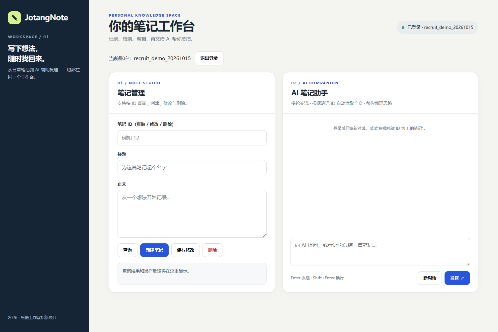
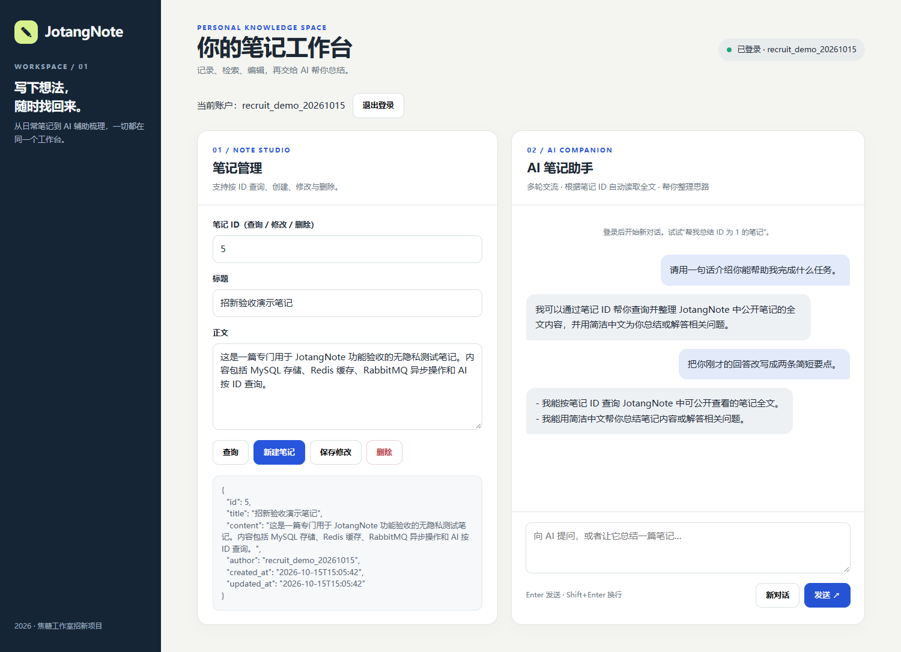
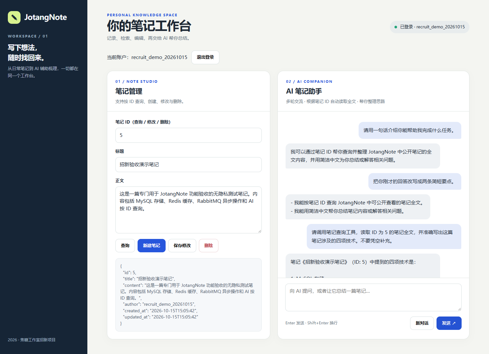

# 进阶篇：多轮会话、Tool Use 与前端

## 运行效果

启动 FastAPI 后打开 `http://虚拟机IP:8080/`，登录后就能管理笔记和与 AI 对话。前端只有一个 HTML 文件，使用 `fetch` 请求 FastAPI，不需要另外启动前端服务器。

同一会话下可以追问。下面先让 DeepSeek 介绍能做什么，再要求它根据上一条回答整理成两点。

AI 还可以按 ID 查询笔记。下面读取的是专门创建的测试笔记 ID 5，模型回答正确列出了原文中的四项技术；测试后这篇笔记已删除。

## 代码思路

### `/chat` 和会话历史

`app.py` 先校验用户 JWT，再通过 `get_session()` 获取该用户的会话。首次聊天会生成新的 `conversation_id`；继续聊天时由前端传回原 ID。

`chat_session.py` 用字典保存会话历史，每轮包含用户提问、可能发生的工具调用及结果、最终回复。历史按整轮裁剪，避免工具调用与结果不匹配。当前最多保留最近 10 轮，空闲 30 分钟后过期；重启服务会清空会话。

### Tool Calling

模型只能提出工具调用请求，真正执行查询的是我们的 Python 后端。

~~~text
用户消息 → FastAPI /chat → 模型
                          ├─ 直接回答
                          └─ 返回 tool_calls
                               → 后端校验参数
                               → 调用 get_note_by_id
                               → Redis / MySQL 查询
                               → 把工具调用和结果写入上下文
                               → 再请求模型生成回复
~~~

`ai_client.py` 向模型声明 `get_note_by_id` 的参数格式，然后检查模型返回的工具名、JSON 参数和正整数笔记 ID。处理后会把 `assistant` 的 `tool_calls` 记录、对应 `tool_call_id` 的 `tool` 结果和最后的回复一并保留在会话中。中间的 JSON 不直接显示到前端。

该工具只有只读查询能力，没有开放删除和修改。模型返回错误参数或不存在的笔记时，后端把错误信息返回模型，工具调用次数也有上限。

### 前端和模型服务

`Project/web/index.html` 的功能包括登录、笔记增删改查、异步任务状态轮询和聊天。登录的 JWT 放在当前浏览器的 `sessionStorage` 中；上游 API Key 只留在服务器 `.env`，不会发给浏览器。笔记内容与 AI 回复使用 `textContent` 显示。

前端页面使用 AI 工具辅助开发，并在浏览器中调试了登录、笔记操作和聊天。

模型目前通过 YosHub 的兼容接口调用 DeepSeek；`.env.example` 中有配置格式，使用时将真实 `AI_API_KEY` 填在本机的 `.env` 中。第三方模型可能收到提问和查询到的笔记正文，所以演示时使用无隐私测试笔记。

## 测试和限制

2026-10-15 在浏览器上测试了登录、多轮聊天和按 ID 查询笔记。自动化测试命令：

~~~bash
.venv/bin/python -m unittest discover -s Project/tests -v
~~~

项目共 46 项自动化测试通过，其中 `test_chat.py` 和 `test_chat_advanced.py` 覆盖会话归属、上下文、工具参数及异常处理。部分测试使用模拟服务；此外完成了真实 DeepSeek 和数据库的网页联调。

目前会话只保存在内存中；没有实现 Bonus 的持久化、全文搜索或更多工具。`GET /notes/{id}` 当前对所有用户开放，项目也未设计私密笔记的读取权限，因此不应拿敏感笔记进行演示。
