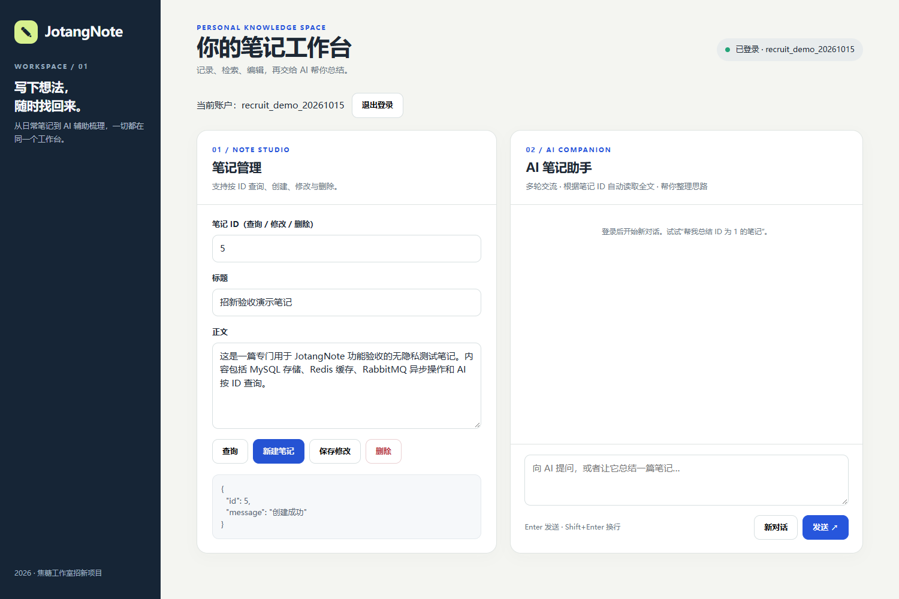

# 用户登录认证与笔记作者权限

## 功能流程

1. `POST /register`：注册用户，使用 Argon2 保存密码哈希。
2. `POST /login`：按用户名查询并验证密码；成功返回 `access_token`、`token_type=bearer`，以及 `expires_in=7200` 秒（2 小时）。
3. 后续调用 `POST /notes`、`PUT /notes/{note_id}`、`DELETE /notes/{note_id}`，需要携带请求头 `Authorization: Bearer <token>`。
4. `get_current_user` 通过 `Depends` 取得 Token，校验 JWT 签名、`exp` 过期时间和 `sub` 用户 ID，并查询该用户是否仍存在。
5. 新增笔记时作者从当前用户取得，不再由请求 JSON 指定；修改、删除笔记时核对作者，拒绝非作者操作（403）。
6. `GET /notes/{note_id}` 仍可公开查询。

## 核心思路

- JWT 是**签名令牌**，而不是加密文本，载荷中只保存用户 ID（`sub`）和过期时间（`exp`），不包含密码。
- 服务器用 `JWT_SECRET_KEY` 验证签名，无需每次重新输入密码；过期后重新登录。
- `HTTPBearer` 负责读取请求头，`Depends` 复用认证逻辑。
- 采用 **HS256** 和 **120 分钟**有效期，是本项目选择，不是招新题指定的技术。
- 旧的 `notes.author` 字符串列保留，不做表迁移。旧笔记的作者字符串需与现有用户名一致，才能由该账号修改或删除。用户身份不能由客户端直接传入的 `author` 决定。
- 这里不包含主动立即注销、刷新令牌或跨设备会话管理；如以后需要，可加入 Redis 管理会话/撤销令牌。

## 环境和启动

项目使用 Python 3.13 的独立虚拟环境 .venv，Ubuntu 系统 Python 3.10 保持不变。旧的项目环境备份为 .venv-py310-backup，不提交 Git。进入项目根目录后，使用：

```bash
.venv/bin/python --version  # 应为 3.13.x
.venv/bin/python -m pip install -r requirements.txt
```

项目根目录 `.env` 已在本地生成独立随机 `JWT_SECRET_KEY`，`gitignore` 会忽略它。其他机器部署时需要各自生成新的密钥（例如 `openssl rand -hex 32`），不要提交到 Git。源码通过 `python-dotenv` 读取 `.env`。

MySQL 密码仍需通过环境变量提供，不写入仓库：

```bash
read -rsp "DB_PASSWORD: " DB_PASSWORD
echo
export DB_PASSWORD
.venv/bin/uvicorn app:app --app-dir Project/src --host 0.0.0.0 --port 8080 --reload
```

## Swagger 实际验收清单

打开 `http://<Ubuntu虚拟机IP>:8080/docs`：

1. 调用 `POST /login`，正确密码应返回 200 和 Token，错误密码返回 401。
2. 点击右上角 **Authorize**，填入返回的 Token（无需手动添加 `Bearer `）。
3. 调用 `POST /notes` 创建笔记，验证作者自动为当前用户。
4. 使用另一个已注册账号的 Token，尝试修改/删除第一位用户的笔记，应为 403。
5. 用原作者的 Token 修改/删除，应该成功。
6. 不带 Token 或携带过期 Token 的写请求应返回 401。

## 2026-10-15 真实浏览器登录与笔记操作截图

使用 Windows Edge 浏览 Ubuntu FastAPI 网页，专门注册非个人账号 `recruit_demo_20261015`，经真实 `POST /register` / `POST /login` 登录成功；网页显示登录账号、启用新增/修改/删除按钮。随后以该账号创建无隐私笔记 ID 5，经异步 Worker 完成并由 `GET /notes/5` 回读，返回标题、正文、作者和时间。修改后也通过网页显示「修改成功」；截图中未展示密码、JWT 或个人数据。





测试结束后 ID 5、6 均执行删除且再次 GET 为 404。跨账号修改/删除返回 403 仍以既有自动化测试为证据，**本轮没有声称取得跨账号的真实浏览器截图**。测试账号本身尚留在测试用 `users` 表，后续可由数据库管理员清理。

## 测试与证据边界

自动化测试在 `Project/tests/test_auth.py`，可用：

```bash
.venv/bin/python -m unittest discover -s Project/tests -v
```

2026-10-14 在 Python 3.13 中使用 FastAPI TestClient 和模拟数据库运行 8 个测试，通过；测试环境使用 httpx2，不再出现旧版 httpx 弃用警告。这只能证明接口认证逻辑，并非真实 MySQL 的 HTTP 端到端测试。Swagger 的实际联调与流程截图尚待补充；成功以后应把截图、运行步骤与测试结果归档到项目文档中，不预先伪造截图或验收状态。
