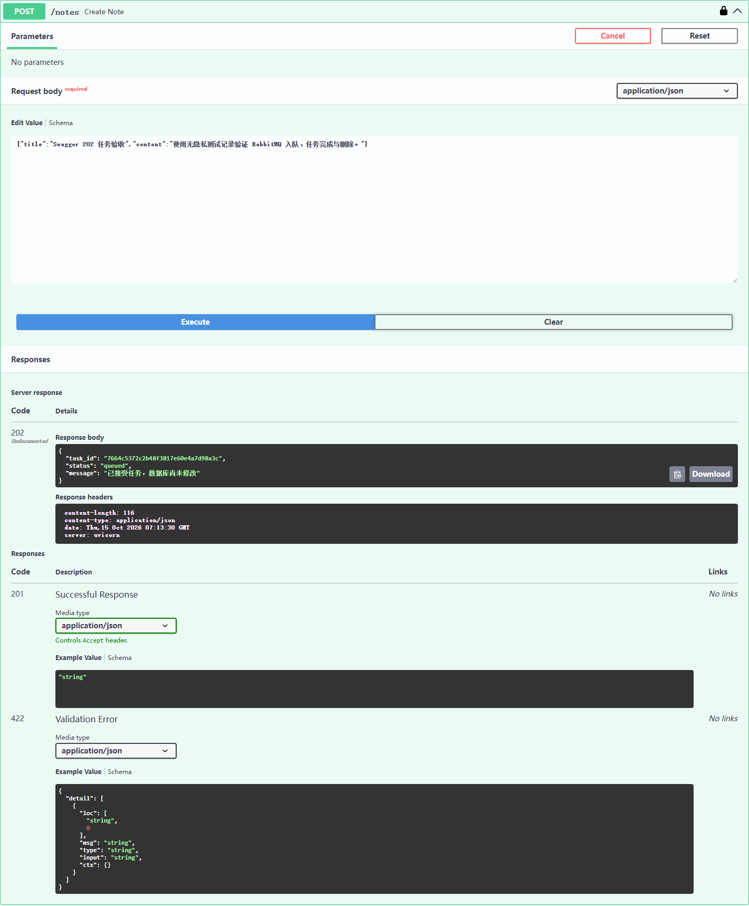
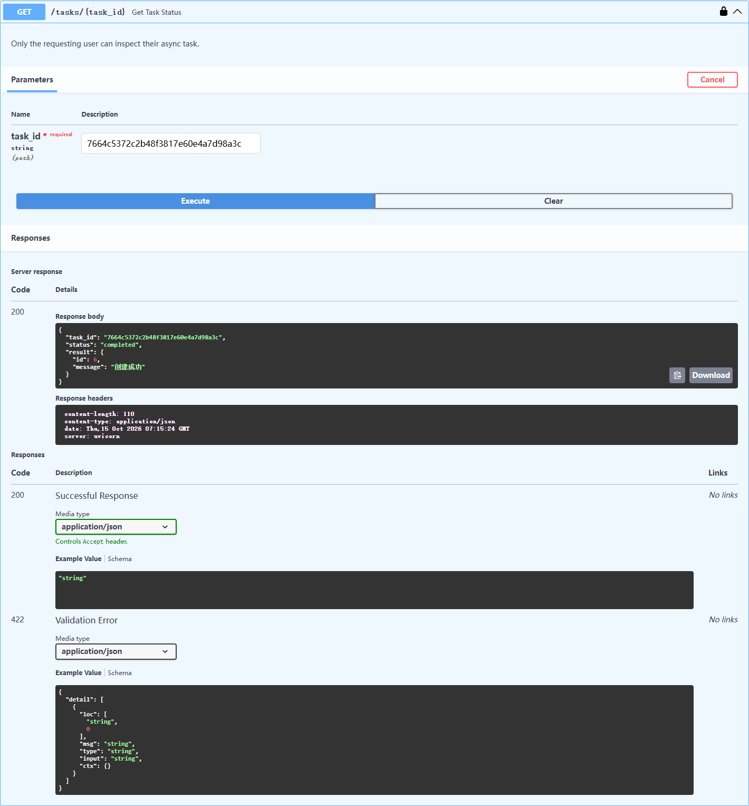
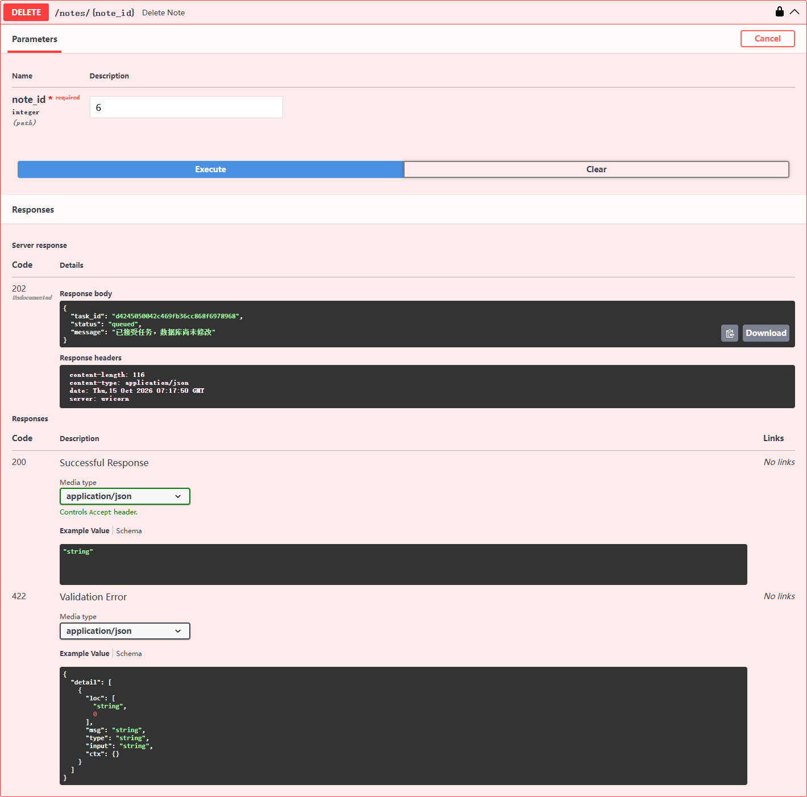

# RabbitMQ 笔记异步操作（入门篇 Part 3）

## 目的和实际行为

原来请求 → FastAPI → MySQL 操作完成 → HTTP 结果。异步版为：

1. 客户端带 Bearer Token 发送 POST/PUT/DELETE；FastAPI 验证身份。
2. 接口创建任务 ID，将任务状态写入 Redis，再通过 RabbitMQ 投递持久化消息。Broker 确认投递后返回 HTTP **202 Accepted**，表示**已入队，不代表数据库操作已成功**。
3. 独立运行的 `note_worker.py` 订阅队列，从消息里读取操作种类、目标笔记及用户 ID，重新从 MySQL 查询用户，调用现有的 CRUD 数据库函数执行实际更改；修改和删除仍会校验作者，成功后失效 Redis 笔记缓存。
4. Worker 记录任务最终结果，然后向 RabbitMQ 发送 ACK。客户端通过 `GET /tasks/{task_id}` 查看自己任务的 `queued / processing / completed / failed` 状态。

采用三个文件：`note_queue.py` 负责创建与发布任务、缓存任务状态；`note_worker.py` 消费执行；`app.py` 中接口复用现有的 `*_db` 函数。没有引入第二套不一致的 SQL。

## Ubuntu 环境和启动

RabbitMQ 服务端需要 sudo 安装，**由用户亲自执行**：

```bash
sudo apt update
sudo apt install -y rabbitmq-server
sudo systemctl enable --now rabbitmq-server
sudo systemctl status rabbitmq-server
```

首次创建非管理员业务账户（只在自己 Ubuntu 终端运行，切勿把密码发给聊天）：

```bash
cd ~/jotang-recruit/JotangNote
MQ_PASS=$(openssl rand -hex 24)
sudo rabbitmqctl add_user jotang "$MQ_PASS"
sudo rabbitmqctl set_permissions -p / jotang ".*" ".*" ".*"
printf '\nRABBITMQ_USER=jotang\nRABBITMQ_PASSWORD=%s\n' "$MQ_PASS" >> .env
unset MQ_PASS
chmod 600 .env
```

本示例用户只授予默认 vhost (`/`) 权限，不授予 management/admin 标签。生产系统应该进一步划分 vhost、队列与最小权限、配置 TLS 并限制网络监听。Ubuntu 默认可能对整个网段监听 5672；本项目 API 与 Worker 均在同一 VM，建议最终只让 RabbitMQ 监听 127.0.0.1，需要 sudo 修改系统配置，不属于 Python 客户端自行控制的范围。若用户已存在，需要通过交互式安全方式更新密码，而不是再次 `add_user`。

先运行一个**独立进程**作为 Worker。由于当前已有 MySQL 密码通常只通过运行 API 的终端环境变量提供，新开的 Worker 终端也要独立设置（不把数据库密码提交到 Git）：

```bash
cd ~/jotang-recruit/JotangNote
read -rsp "DB_PASSWORD: " DB_PASSWORD
echo
export DB_PASSWORD
.venv/bin/python Project/src/note_worker.py
```

另一个终端重启 API 进程，并在项目根 `.env` 设置 `NOTE_WRITE_MODE=async`（提交示例 `.env.example` 已配置 `async`；须确保 RabbitMQ 和 Worker 同时运行），再启动：

```bash
.venv/bin/uvicorn app:app --app-dir Project/src --host 0.0.0.0 --port 8080
```

注意：仅重新修改 `.env` 不能保证已在运行的 Python 进程自动加载，**需要重启 API**；Worker 启动时也必须能读取密钥、数据库凭据。与现有 `DB_PASSWORD` 配置同理。

## Swagger 实测步骤（后续复测参考）

1. 在 Swagger `/docs` 登录并 Authorize。创建一篇**专用测试笔记**，预期 HTTP 202 + `task_id`，不要误认为已立即入库。
2. `GET /tasks/{task_id}` 预期先后看到 `queued/processing` 与 `completed`；取回完成结果中的笔记 ID，调用 `GET /notes/{id}` 查真实 MySQL 与缓存。
3. 提交 PUT，等任务完成后 GET 确认是新内容、缓存已失效；DELETE 同理，完成后 GET 应返回 404。
4. 换另一个用户提交修改/删除任务，应在 Worker 最终显示 `failed`（403），数据不变；尝试读取他人 task 应为 403。
5. 临时停 Worker，仅投递到 RabbitMQ，确认任务保持 queued；重启 Worker 后完成。再测试 RabbitMQ 不可用时新写请求应返回 503 而不是假成功。
6. 将测试笔记清理干净，留存必要的 Swagger/队列/结果截图及真实 HTTP 结果，再交付 Git。

## 测试过程

- 先启动 RabbitMQ、Redis、MySQL、Worker 和 FastAPI，设置 `NOTE_WRITE_MODE=async`。
- 在 Swagger 登录并提交笔记新增请求，返回 202 和任务 ID；通过任务状态接口查到 `completed`，再 GET 笔记确认已写入 MySQL。
- 异步修改笔记后，新的内容可查询且对应旧 Redis 缓存被删除；异步删除笔记后，再次查询返回 404。
- `test_async.py` 覆盖任务查询权限、消息发布失败、Worker 错误、ACK 等分支。当前并未实现严格的重复消息幂等保证，这部分属于加分项。

## HTTP 202 与任务完成截图

在 `NOTE_WRITE_MODE=async`、RabbitMQ、Redis、MySQL、Worker 均运行时，通过 Swagger 的真实 `POST /notes` 新建无隐私测试笔记，请求返回 HTTP **202 Accepted**，`task_id=7664c5372c2b48f3817e60e4a7d98a3c`，初始状态 `queued`，响应明确提示数据库尚未修改。



继续通过已认证的 `GET /tasks/{task_id}` 查询，真实响应为 HTTP **200**、`status=completed`、`result.id=6`、`message=创建成功`；这是实际消息已由 Worker 处理并执行数据库写入后的业务结果。



随后通过 Swagger 异步 DELETE 删除笔记 ID 6，并通过同一测试账号删除此前网页建立的笔记 ID 5；两者后续真实 GET 均返回 **404**，Redis 对应笔记缓存键均不存在。



Swagger 截图中隐藏了含 Authorization 的 Curl 命令区；真实任务已由 Worker 完成。崩溃恢复、严格幂等和消息乱序未做生产级保证。

## 技术与边界

- `queue_declare(..., durable=True)` 使队列元数据重启后保留；`delivery_mode=2` 请求消息持久化；`confirm_delivery()` + `mandatory=True` 检查 Broker 是否确认接收消息。
- `basic_qos(prefetch_count=1)` 和单个 Worker 将未确认消息限制为一条，降低乱序风险；`auto_ack=False` 与执行后 `basic_ack` 让消息在处理前不会自动删除。
- Redis 的 `jotang:task:<id>` 仅保存进度与结果，TTL 为一天，不是永久任务历史；原有 `jotang:note:<id>` 保存的是笔记查询缓存，两者分开。
- **可靠性限制：** 当前是招新教学实现，并不保证严格的 exactly-once：Worker 在 MySQL commit 后、保存完成状态/ACK 前崩溃时 RabbitMQ 可能重投递，尤其是 create 有重复创建风险；若 MySQL 已成功而 Redis 状态更新失败，也可能让状态滞留在 processing。当前代码会记录日志并避免因完成状态写入失败而主动再次执行数据库写入。生产设计需增加 MySQL 任务表/唯一任务 ID、事务内幂等检查、持久化结果与故障恢复。题面将顺序性与幂等性强化列为加分项，这里暂不声称已完成。
- 本项目 `.env.example` 和当前实际 `.env` 均配置 `NOTE_WRITE_MODE=async` 以符合招新要求；代码在没有设置开关时回退为同步模式，便于早期无 Broker 的 CRUD 学习。切换是系统整体开关，非请求参数。
