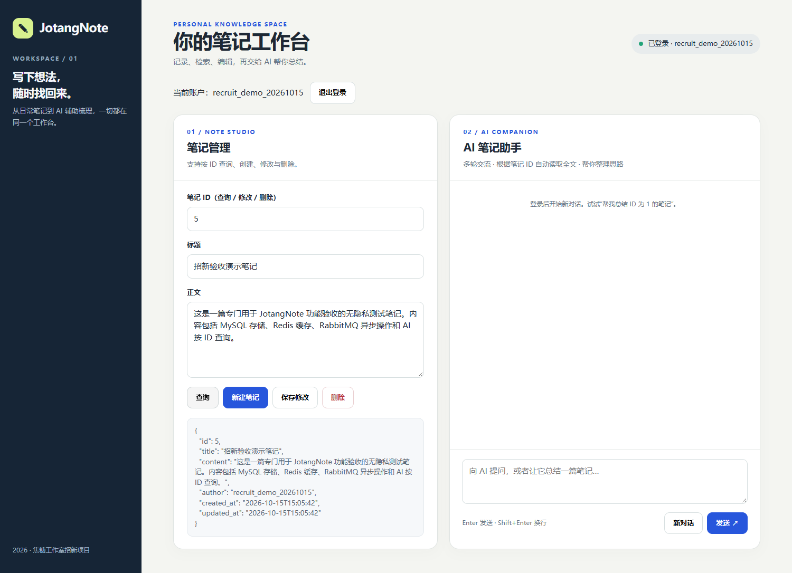
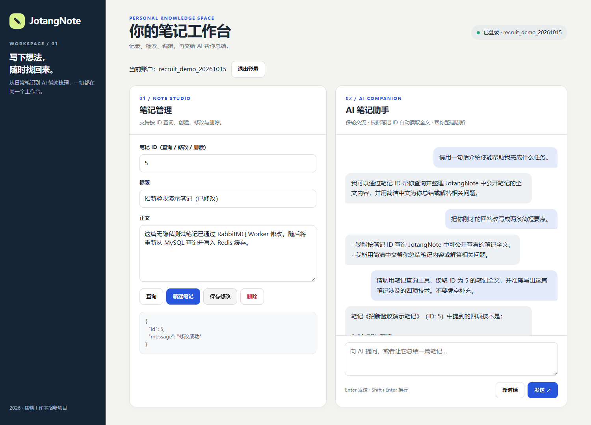

# Redis 笔记查询缓存（入门篇 Part 2）

## 目标与实现

`GET /notes/{note_id}` 采用 Cache-Aside（旁路缓存）：

1. 先读取 Redis 键 `jotang:note:{id}`，命中则直接返回。
2. 未命中时查询 MySQL；不存在则返回 404（当前不缓存空结果）。
3. MySQL 查询成功后把笔记转成 JSON 写入 Redis，TTL 为 300 秒，再返回。
4. `PUT` / `DELETE` 仅在 MySQL `commit()` 成功后删除对应缓存键；新建笔记无需删除已有缓存（本项目没有空值缓存）。
5. Redis 连接失败或读写失败时，查询继续回退 MySQL；Redis 缓存不是数据库。

代码位于 `Project/src/note_cache.py` 和 `Project/src/app.py`。缓存 JSON 的日期字段转为 ISO 格式字符串，以保持 FastAPI 实际响应形式一致。

## 环境准备

项目 Python 虚拟环境已安装 `redis==7.4.1`（Python 客户端），**这不等于安装 Redis 服务端**。Ubuntu 若尚无 Redis 服务，请用户亲自执行以下需要 sudo 的命令：

```bash
sudo apt update
sudo apt install -y redis-server
sudo systemctl enable --now redis-server
```

Redis 仅供本机 API 使用，不要向公网开放 6379 端口。然后无需 sudo 检查：

```bash
redis-cli ping
# 期望：PONG
```

应用默认连接 `redis://127.0.0.1:6379/0`。如需变更，可在项目根目录本地 `.env` 添加 `REDIS_URL=...`；不要提交包含密码的 `.env`。

随后按项目 [README](../../README.md) 中的步骤提供 `DB_PASSWORD` 并启动 Uvicorn（JWT_SECRET_KEY 已从 `.env` 读取）。

## 复测方法

1. 用已存在的笔记 ID 请求一次 `GET /notes/{id}`；再请求一次，应命中 Redis。
2. 在 Ubuntu 终端检查缓存：

   ```bash
   redis-cli GET jotang:note:42
   redis-cli TTL jotang:note:42
   ```

   将示例 `42` 换成真实笔记 ID。首次 GET 后，TTL 应在 0–300 秒间；再次命中一般不会重置 TTL。

3. 使用有效 JWT 更新该笔记（PUT）；在成功响应后检查 `redis-cli EXISTS jotang:note:42` 应为 `0`，再 GET 应返回新内容并重建缓存。
4. 删除自己的笔记（DELETE）成功后，缓存键应不存在；再次 GET 应为 404。
5. Redis 停止或不可达时，GET 应继续从 MySQL 返回结果；恢复 Redis 后可以重新生成缓存。

**测试记录：** 自动化测试覆盖缓存未命中回源、命中后不再查数据库、300 秒 TTL、更新/删除后的失效、404 不缓存和 Redis 故障降级。实际服务联调中，MySQL 查询返回的笔记能写入 Redis，再次请求能从缓存读取；2026-10-15 又验证了真实异步 PUT/DELETE 完成后缓存键被清除。

## 10 月 15 日的网页操作截图

在已启动的真实 API、MySQL、Redis 及异步 Worker 上，以无隐私测试笔记 ID 5 复测：

- 浏览器真实 GET 返回 200 后，用 Ubuntu `redis-cli TTL jotang:note:5` 检查，TTL 为 **290 秒**、`EXISTS` 为 **1**（配置 TTL 300 秒；读取/传输已消耗少量时间）。
- 在网页通过异步 PUT 修改同一笔记并收到「修改成功」后，`redis-cli EXISTS jotang:note:5` 为 **0**、TTL 为 **-2**，说明 Worker 完成数据库提交后旧缓存被删除。
- 后续异步 DELETE 测试笔记 ID 5/6 后，真实 GET 均返回 404，对应 Redis 键 `EXISTS` 均为 **0**。





截图记录了笔记查询和修改结果；Redis 的 TTL、EXISTS 值为同一次测试中在 Ubuntu 终端检查得到的结果。

## 官方思考题

- **缓存一致性：** 当前在 MySQL commit 后删除 Redis 缓存，同时设置 300 秒 TTL 作为兜底。Redis 删除失败、并发 GET 与 PUT 交错仍可能短暂返回旧值；当前实现是最终一致，不是严格一致。
- **缓存穿透：** 对不存在的 ID，可增加短 TTL 的空值缓存（例如 20 秒）或布隆过滤器。当前保留简单实现，未启用空值缓存。
- **缓存击穿：** 热门键过期时可引入互斥锁、提前刷新或不同过期时间；当前未实现，不能假定已解决。

后续 RabbitMQ 异步写入引入后，需要重新审视缓存删除的时机：应在数据库实际更新提交成功时，而不是请求刚入队时。
